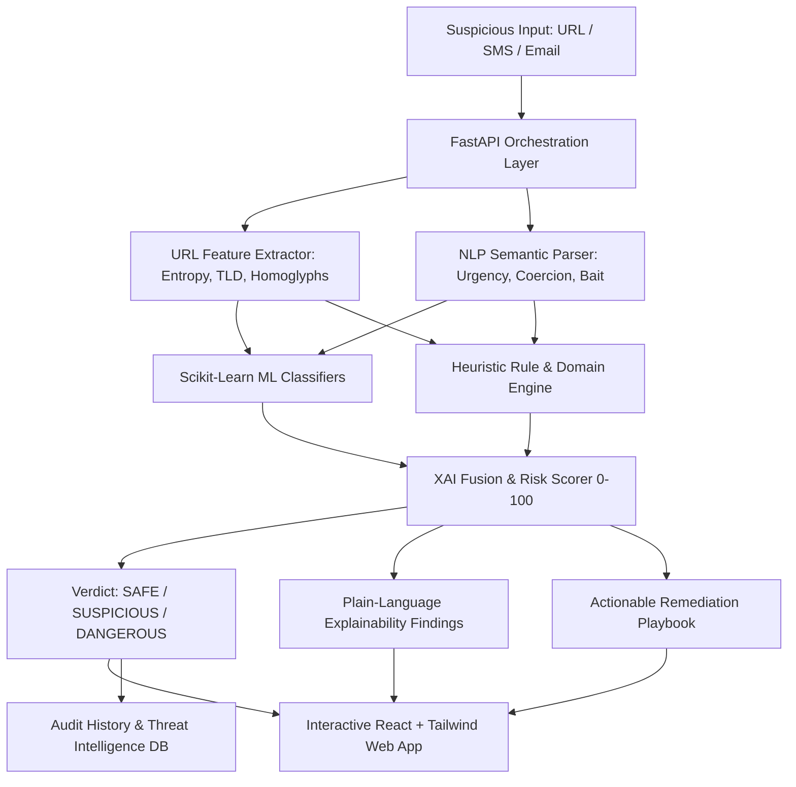

# PhishGuard AI 🛡️
### AI-Powered Digital Scam & Phishing Protection
**HacXLerate 2026 • Team Elite Squad**

---

## 📌 Executive Summary
PhishGuard AI is an **explainable, multi-channel cybersecurity defense platform** engineered to detect, demystify, and counteract modern digital scams and phishing attacks before damage occurs.

Unlike traditional blocklist-based scanners that fail against newly registered burner domains and nuanced psychological manipulation, PhishGuard AI leverages a **hybrid architecture** combining **Machine Learning (Random Forest & NLP Logistic Regression)** with an **interpretable heuristic rule engine** to analyze URLs, SMS/chat messages, and spoofed emails.

---

## 🚀 Key Features

### 1. 🌐 Multi-Channel Threat Scanner
- **URL Phishing Scanner**: Dissects domain entropy, suspicious TLDs (`.xyz`, `.top`, `.buzz`, `.cfd`), typosquatting/homoglyphs (`paypa1`, `arnazon`), deceptive subdomain chains, and raw IP addresses.
- **Scam Message Analyzer (SMS / WhatsApp / Telegram)**: Evaluates high-pressure urgency cues, legal intimidation/extortion threats, fake lottery/crypto rewards, and sensitive credential solicitation (KYC, PAN, OTP).
- **Email Risk Analyzer**: Detects display name spoofing (`PayPal Support <billing@fake-domain.xyz>`), subject line aggression, and malicious embedded links.

### 2. 🧠 Explainable AI (XAI) Engine
- Produces a transparent **0–100 Unified Risk Score** categorized into:
  - 🟢 **SAFE (0–29)**
  - 🟡 **SUSPICIOUS (30–69)**
  - 🔴 **DANGEROUS (70–100)**
- Clear, plain-English breakdown of *why* an alert was triggered, translating technical signals for students, families, and seniors.
- Threat vector radar breakdown: *Domain Trust*, *Brand Integrity*, *Urgency Intensity*, *Credential Theft Risk*.
- **Actionable User Playbook**: Exact next steps (*Avoid, Block, Report, Verify via official channel*).

### 3. 🎯 1-Click Judge Presets
Instant demo buttons covering all three risk tiers:
- **Safe**: Legitimate Google Drive sharing links, official Amazon delivery updates, and campus reminders.
- **Suspicious**: Burner-domain contest giveaways and unverified Telegram part-time job solicitations.
- **Dangerous**: Typosquatted PayPal credential harvesters, urgent bank account freeze SMS with fake KYC links, and spoofed Netflix suspension emails.

### 4. 📊 Threat Intelligence & Security Dashboard
- Real-time telemetry metrics: Total Scans, Dangerous Blocked, Suspicious Flagged, Threat Detection Rate.
- Active attack vector trend breakdown.
- Filterable and searchable audit history log with one-click full detail inspector and JSON export.

### 5. 🧩 Client Integration Simulator
- **Chrome Extension Simulator**: Demonstrates live, in-browser pre-click intervention and blocking before visiting malicious pages.
- **Mobile Guard Simulator**: Demonstrates real-time smartphone notification intercepting fraudulent SMS messages.

### 6. ⚡ Developer API Playground
- Interactive REST testing console with live request/response inspection and ready-to-copy **cURL** and **Python** code snippets.

---

## 🏗️ System Architecture



---

## 💻 Tech Stack
- **Frontend**: React 18, Vite, Tailwind CSS, Lucide React Icons
- **Backend**: Python 3.14, FastAPI, Uvicorn, Pydantic
- **AI & NLP**: scikit-learn (Random Forest, Logistic Regression, TF-IDF Vectorizer), NumPy
- **Persistence**: Structured JSON Audit Store & Telemetry Engine

---

## ⚡ How to Run

### Method 1: Instant 1-Click Launch (Recommended)
Double-click `run.bat` in the project root:
```cmd
run.bat
```
*This starts the FastAPI service and automatically launches the web application at **`http://127.0.0.1:8000`**.*

### Method 2: Live Development Mode
Double-click `dev.bat`:
```cmd
dev.bat
```
- Frontend Dev Server: `http://localhost:5173`
- Backend API Docs: `http://127.0.0.1:8000/docs`

---

## 👥 Team Elite Squad • HacXLerate 2026
*Protecting digital communities through explainable artificial intelligence.*
